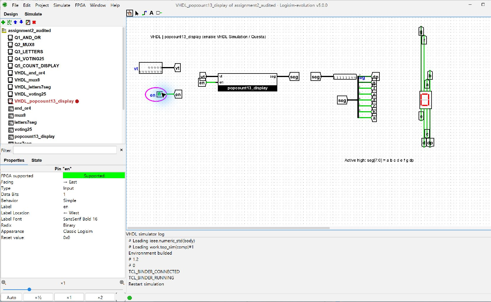
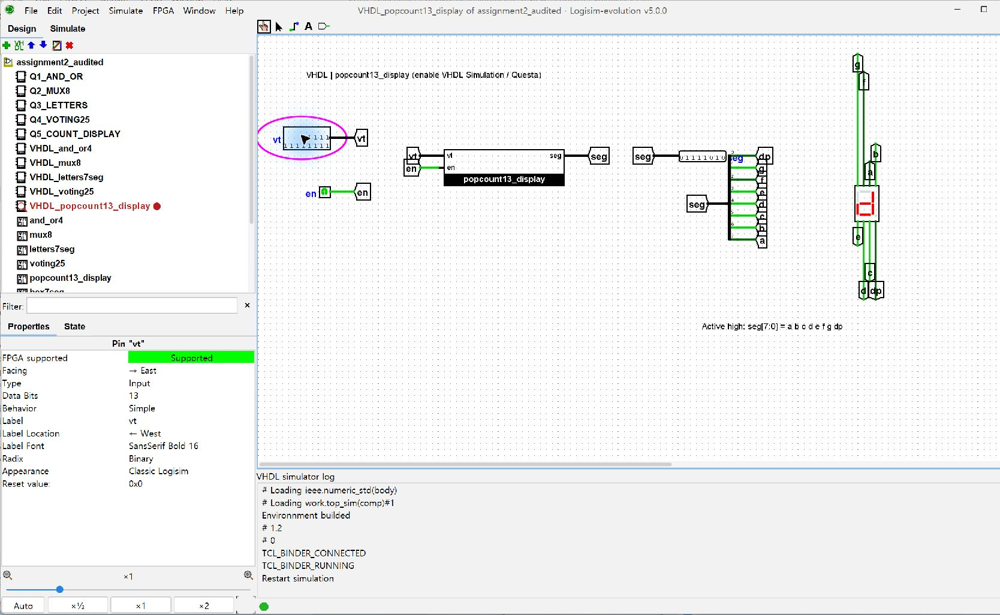
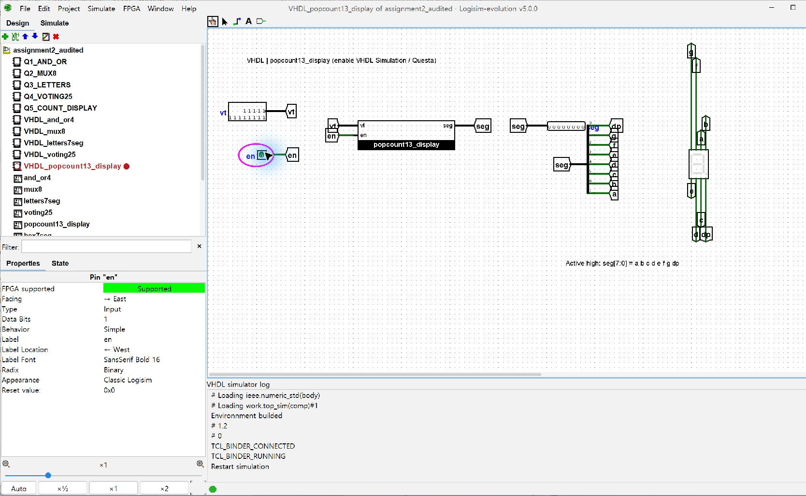

# Assignment-2 재검토 기록

검토일: 2026-10-27. 원문: 디지털논리회로설계 `VHDL_1`, 22쪽, `1.4 Problems`.

## 원문과 구현 대조

| 원문 요구 | 제출 구현 | 확인 방법 | 판정 |
| --- | --- | --- | --- |
| 1. `out1 <= a and b and c and d`, `out2 <= a or b or c or d` | `and_or4.vhd`, `Q1_AND_OR` | 입력 16개 전수 검사, 출력은 정확한 std_logic 0/1로 비교 | 충족 |
| 2. 8-to-1 Multiplexer | `mux8.vhd`, `Q2_MUX8` | 데이터 256개 × 선택 8개 = 2,048개 | 충족 |
| 3. a,b,c,d,f,g 표시 | `letters7seg.vhd`, `Q3_LETTERS` | 선택값 8개 검사, 획 이름으로 독립 계산한 기대값과 비교 | 충족, 글꼴 선택은 아래 명시 |
| 4. 25인 투표기 | `voting25.vhd`, `Q4_VOTING25` | 과반수 조건은 13명 이상. 모든 찬성 수/회전 패턴/고정 난수를 포함한 8,791개 | 충족, 전수 검사는 아님 |
| 5. 13비트 vt의 1 개수 표시 및 en 소등 | `popcount13_display.vhd`, `Q5_COUNT_DISPLAY` | 입력 8,192개 × en 2개 = 16,384개 전수 검사 | 도달 가능한 모든 입력에서 충족 |
| 5번의 10~15 → A~F 표기 | 실제 개수 10~13은 A,b,C,d. 보조 `hex7seg.vhd`에서 0~F 전체 정의 | 독립된 획 기준 16개 표 검사 | 14/15는 13비트 입력에서 도달 불가 |
| .vhd / .circ / PDF를 본인 GitHub에 업로드 | `src/`, `logisim/assignment2.circ`, `report/assignment2_report.pdf` | 공개 저장소에서 다운로드 확인, 7쪽 PDF 렌더링 확인 | 충족 |
| LMS에 저장소 링크 제출 | `https://github.com/cho-crypto/not_gate_ass` | 계정 프로필과 저장소 링크를 구별 | 링크 제공 완료. LMS 제출 자체는 수행하지 않음 |

## 발견해서 수정한 사항

1. **테스트의 엄밀성:** 기존 Q1/Q4 검사는 `(output='1') = expected_boolean`을 사용했다. expected가 false인 경우 X 등도 통과할 수 있는 약점이었다. `output = expected_std_logic`으로 바꾸어 정확한 0/1을 검사한다. 보강한 기존 테스트 27,263개가 모두 통과했다. 기본 VHDL 모듈 자체에서 이진 입력 동작 오류는 발견하지 못했다.
2. **보조 VHDL 회로 사용성:** `VHDL_` 회로들의 외부 입력 핀이 10픽셀 간격이라 긴 버스 핀과 en 핀이 겹칠 수 있었다. 외부 핀 간격을 90픽셀로 넓히고, 포트 이름이 보이는 블록으로 교체했다. 기본 Q1~Q5 회로의 논리 동작은 동일하다.
3. **기대값의 독립성:** 기존 표시 검사 표가 구현 표와 같은 생성 데이터에서 나왔다. 새 `tb_audit.vhd`는 이진 상수를 복사하지 않고, 숫자/문자에서 켜져야 하는 획 이름(a~g)을 독립적으로 지정해 기대값을 만든다. 추가 16,413개 검사가 통과했다.

## 재실행 결과와 증거

- GitHub의 기존 커밋 `6334229`를 새로 clone하고 원래 Questa 테스트를 다시 실행했다: [공개 저장소 스냅샷 재실행 로그](results/remote_snapshot_check.log).
- 보강한 Questa 회귀 검증: **27,263개 통과**, Errors 0 / Warnings 0: [로그](results/questa_results.log).
- Logisim 기본 회로: **27,247개 통과**, 모든 회로 Failed 0: [기계 판독 결과](results/logisim_summary.json).
- 독립 표시 기준/비이진 입력 검증: **16,413개 통과**, Errors 0 / Warnings 0: [로그](results/independent_audit.log).
- `.circ`에 내장한 **6개 VHDL 소스가 개별 .vhd 파일과 일치**함을 비교했다. 보조 회로 개선 전후로 문제별 VHDL 소스의 논리 동작은 바뀌지 않았다.
- 수정한 보조 `VHDL_popcount13_display`를 Logisim-Questa로 직접 실행하여 `vt=0,en=1`의 0 표시, `vt=8191,en=1`의 d(13) 표시, 같은 vt에서 `en=0` 소등을 확인했다.

### 실제 VHDL 연동 화면







## 해석과 검증 한계

- 원문은 문제 3의 입력 선택 방식이나 글꼴 비트표를 지정하지 않았다. 3비트 선택기를 사용하고 7세그먼트 글꼴을 A,b,C,d,F,G로 명시했다. G는 a,c,d,e,f,g를 켜므로 숫자 6과 같은 모양이다. 정확한 소문자 글꼴 형태를 요구하는 별도 채점 기준이 있다면 이 부분은 그 기준에 맞춰야 한다.
- 13비트의 1 개수는 최대 13이다. E/F는 실제 vt 입력의 출력으로 검증할 수 없으므로 디코더 단위 검증과 구별했다.
- 25인 투표기는 2^25 전체 입력 전수 검사가 아니라 명시한 표본 검사다. FPGA 합성·실물 보드 검증은 수행하지 않았다.
- 보조 VHDL 연동 회로의 대표 실기 검사는 Q5의 위 3개 상태다. 모든 기본 회로의 이진 입력 자동 검증 및 6개 VHDL 소스 일치 확인과 구별한다.

## 추가 검사 재실행

Questa 사용 가능 상태에서 과제 폴더를 현재 디렉터리로 두고 실행한다. Starter 라이선스는 동시에 한 세션만 가능하므로 Logisim VHDL 연동 실행 중이면 먼저 종료한다.

```sh
vsim -c -do tests/simulate.do -l results/questa_results.log
vsim -c -do tests/audit.do -l results/independent_audit.log
```
